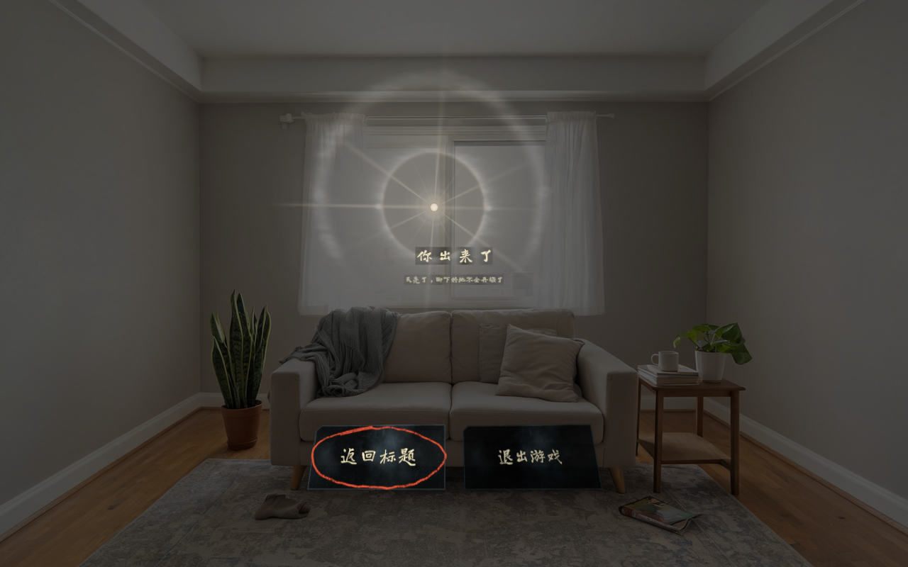
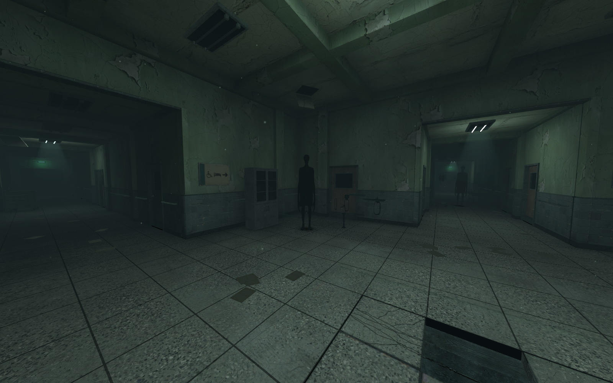
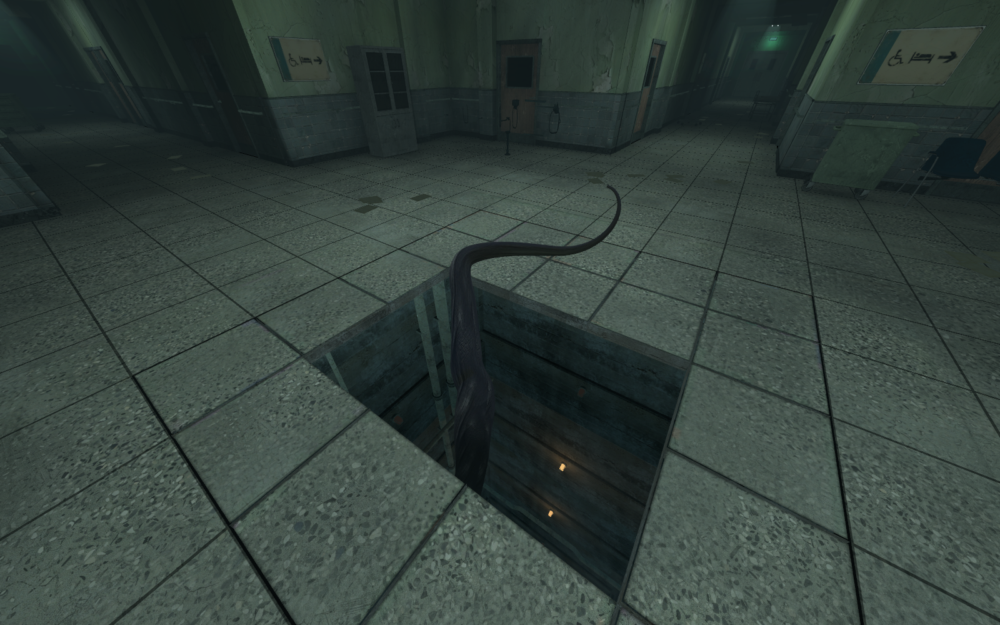
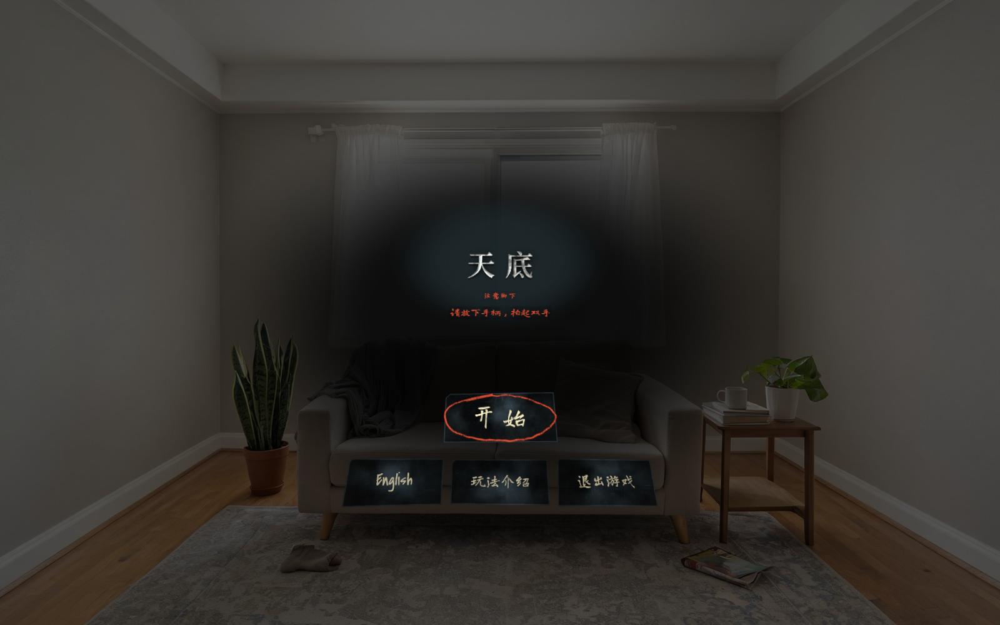
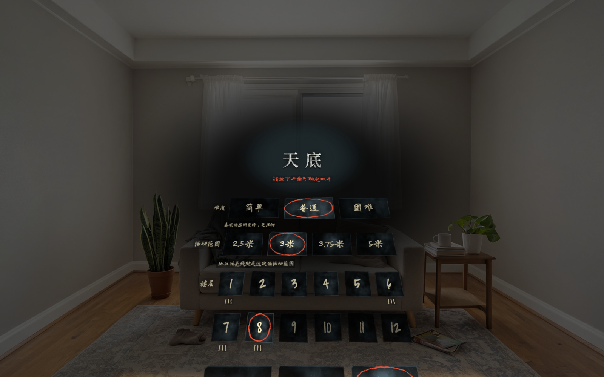

# 天底 NADIR —— 注意脚下

PICO 头显上的混合现实（MR）恐怖游戏，全程只用双手和眼睛，不用手柄。

你站在一片 5×5 的地砖上，脚下是一口四十层深的竖井。地砖会一块块开裂、塌落；黑影从走廊深处慢慢走来；井底有一只巨眼会升上来。你要在地板塌完之前收齐这一层的灯，撕开出口处的裂隙走进去，再往下一层。一共十二层，越往下塌得越快、东西越多。走出最后一道裂隙时，你会在自己的房间里醒来，眼前是清晨的日晕。

“天底”是天文术语，指观察者正下方的那一点。



| | |
| --- | --- |
|  |  |
|  |  |

> 透视模式的截图是在电脑上把游戏画面（带透明度）合成到一张示例房间照片上，模拟头显里看到的效果；真机上背景是玩家自己的房间。

## 玩法

- **地板会塌**：地砖先开裂、再塌落。站在开裂的砖上会掉下去；在一个地方站太久，脚下也会开始裂。掉下去不会直接结束，会真的落进井里，再在本层醒来。
- **收灯开门**：发光的小灯会浮在地板上方，用眼睛盯住再捏合手指就能隔空取到，也可以直接用手碰。收齐这一层的灯，出口会出现一道裂隙，双手抓住往两边撕开，然后走进去。门出现之后地板照样会塌。
- **黑影**：从走廊深处朝你走来。你看着它时它不动，移开视线它就靠近；伸手朝它一推可以把它推远。它贴到区域边上时，附近的地砖会裂开。
- **巨眼**：会从井底升上来。它睁开的时候，别透过破洞往下看；低头朝它挥一下手可以把它拍走。
- **触手**（只在困难模式）：从破洞里伸出来缠你的腿，挥手把它拍回去。
- **暂停**：用一只手的食指点另一只手的手背。抬起手背看一眼，手背上会显示这一层的进度。

难度只改变看到的东西和掉落的节奏，规则一样：

| 难度 | 看到的环境 | 说明 |
| --- | --- | --- |
| 简单 | 你的真实房间 | 透视模式，最温和 |
| 普通 | 压暗的真实房间 | 透视模式，房间被压暗 |
| 困难 | 完整的废弃医院 | 全虚拟场景，触手出现 |

活动范围可选 2.5 / 3 / 3.75 / 5 米，会读取 PICO 系统的安全边界，超出边界的档位不能选。开局前有必读的安全须知（请站着玩、清空周围），第一次开始会进入新手教学（全程不会掉落）。游戏里没有突然贴脸的惊吓，恐怖靠慢慢逼近。

## 当前进度

- 12 层全部可玩，含新手教学和完整结局；中英双语界面。
- 已在 PICO 头显真机上安装测试。
- 规则层可以脱离 Unity 跑机器人对局，用来调平衡（见下文“测试工具”）。

## 环境要求

| 项目 | 版本 |
| --- | --- |
| Unity | 6000.5.5f1 |
| 渲染管线 | URP 17.5 |
| PICO Unity SDK | 6.0.0（**仓库里不含**，见下文） |
| 目标平台 | Android（PICO 头显），需要手部追踪；有眼动追踪时用眼动，没有时用头部朝向代替 |

PICO SDK 在 `Packages/manifest.json` 里用的是本机路径：

```
"com.bytedance.pico.xr": "file:/Users/ld/Library/PICO/UnitySDK/6.0.0/PICO-Unity-SDK/XR"
```

在别的电脑上打开工程前，先从 PICO 开发者网站下载 SDK 6.0.0，再把这一行改成你本机的路径。

## 怎么运行

1. 用 Unity Hub 打开本目录。第一次打开会重新导入资源，需要一段时间。
2. 打开场景 `Assets/_DLD/Scenes/Main.unity`，点 Play，就能在编辑器里玩。编辑器里的操作：

   | 按键 | 作用 |
   | --- | --- |
   | WASD | 走动 |
   | 按住鼠标右键拖动 | 转头 |
   | 空格 | 捏合（取灯） |
   | 鼠标左键 | 挥手拍（触手、巨眼） |
   | F | 伸手推黑影 |
   | G | 双手撕开裂隙 |
   | C | 用手捂眼 |

3. 场景是由代码搭出来的。改了搭建代码之后，依次点菜单 **DLD/1 搭建场景**、**DLD/2 烘焙光照**。
4. 打 Android 包：菜单 **DLD/4 切到 Android**，再点 **DLD/5 打包 APK**；或者用命令行
   `Unity -batchmode -quit -projectPath <工程路径> -buildTarget Android -executeMethod DLD.EditorTools.DLDBuild.BuildBatch`。
   签名用的 `Keystore/` 目录不在仓库里。需要自己生成一个 keystore，放到 `Keystore/nadir.keystore`（别名 `nadir`），并把密码写进 `Keystore/keystore_pass.txt`。

## 目录结构

| 路径 | 内容 |
| --- | --- |
| `Assets/_DLD/Runtime/Logic` | 纯玩法规则：地板塌陷、灯、门、黑影、巨眼、触手、惊吓节奏、十二层的关卡参数、新手教学。不依赖 Unity 表现层，可以单独跑机器人对局 |
| `Assets/_DLD/Runtime/Play` | 表现层：输入（PICO 手部和眼动）、地砖、竖井、黑影、巨眼、触手、传送门、结局、界面、音频导演 |
| `Assets/_DLD/Editor` | 编辑器工具：场景搭建（医院建筑、竖井、地砖都是程序生成）、烘焙、打包、巡检和自检工具 |
| `Assets/_DLD/Shaders` | 自写的 URP 着色器：巨眼、竖井、传送门、裂隙内部、结局的太阳和日晕、界面等 |
| `Assets/_DLD/Art` | 贴图、模型、界面贴图、封面 |
| `Assets/_DLD/Audio` | 音效、环境声和分层配乐（全部由脚本合成） |
| `Tools/` | Python 工具：贴图处理、P2 模型修复和减面、界面文字贴图、封面、音效和配乐合成 |
| `ArtSource/` | 美术源文件：参考图、P2 模型各阶段产物（白模、修复版、审计报告）、贴图原图、字体 |
| `Docs/` | 场景方案、效果图、界面图、封面、[素材来源](Docs/素材来源.md) |

## 做法

- **场景**：医院大厅、走廊、竖井和地砖都是程序建模（`KitBuilder`、`SceneBuilder`），烘焙光照贴图。竖井只能透过地上的破洞看到（模板缓冲），井里的灯光在着色器里按世界坐标计算。
- **贴图**：用 Tripo 生成原图，再用 `Tools/process_tex3.py` 做无缝化、多尺度法线和光泽遮罩，2K 以内。
- **模型**：道具和黑影由 Tripo P2 生成。流程是参考图 → 白模 → 审计开放边和非流形 → 修复 → 逐级减面（每一级都重新审计）→ 贴图。每个模型的审计报告在 `ArtSource/ModelsP2/<名称>/final/report.json`。
- **巨眼**：着色器里做了角膜的光线追踪和折射，虹膜随瞳孔伸缩，会扫视和眨眼。
- **触手**：每帧沿路径重建管状网格，只从破洞里伸出，缩回时沿原路退回。
- **传送门内部和结局的太阳**：画在套着相机的球上，颜色只按视线方向计算，所以看起来在无穷远处、没有视差。日晕参照真实的 22° 晕：白色主环、内缘淡红，还有幻日、上切弧和缓慢飘过的薄云。
- **界面**：做成观片灯上的旧 X 光胶片加蜡笔手写字，选中项用红蜡笔圈出。用手指点按选择。

## 测试工具

| 工具 | 作用 |
| --- | --- |
| `DLD.EditorTools.LogicSim` | 不开场景，直接用规则层让三档水平的机器人跑每一层，统计通关和掉落，用来调平衡 |
| `DLD.EditorTools.EndingCheck.Run(目录, 是否结局)` | 在 Play 里走进传送门，按时间点录下带透明度的画面和状态日志，检查关卡过渡和结局流程 |
| `DLD.EditorTools.GestureCheck.Run()` | 检查拍、推、撕门等手势判定 |
| `DLD.EditorTools.WristCheck.Run()` | 检查手背暂停和进度显示的判定 |
| 菜单 **DLD/3 巡检** | 找出会造成贴图闪烁的共面重叠面，以及道具和建筑之间的穿模 |

## 素材与授权

- **音效、环境声、配乐**：全部由本项目的脚本离线合成（`Tools/make_sfx.py`、`make_amb.py`、`make_music.py`），不含第三方音频。
- **字体**：Noto Sans SC / Noto Serif SC、Long Cang、Covered By Your Grace，均为 SIL OFL 1.1，授权文本在 `ArtSource/Fonts/`。
- **贴图和模型**：由 Tripo 生成后经本项目脚本处理。
- 详见 [素材来源](Docs/素材来源.md)。
